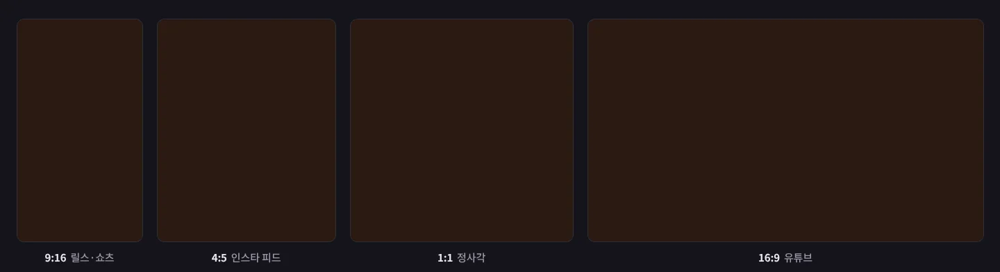
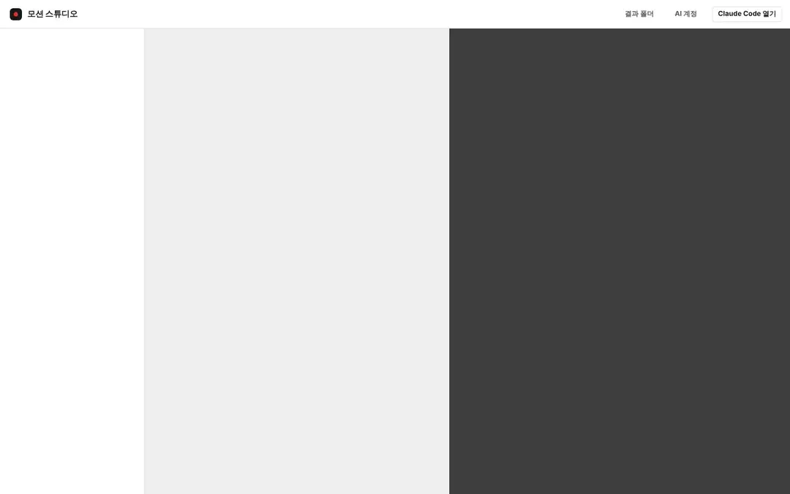
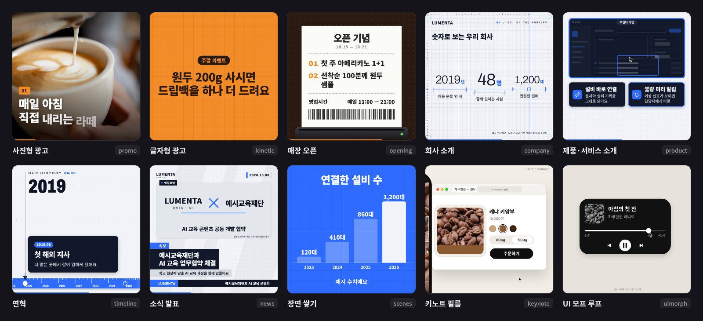
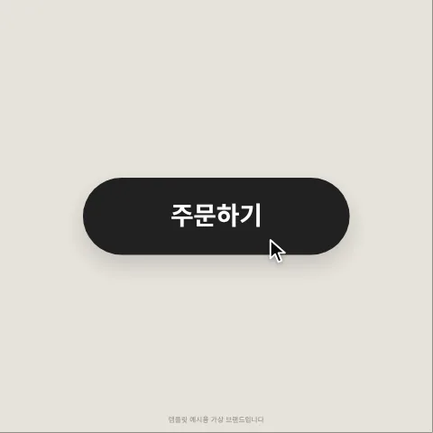
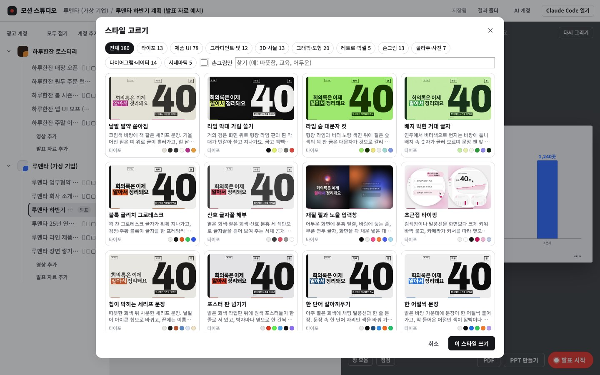
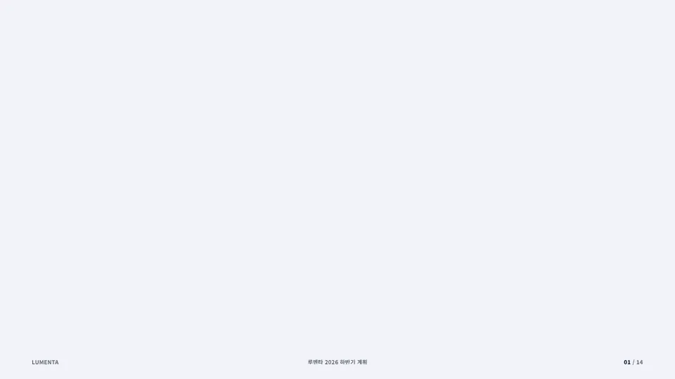
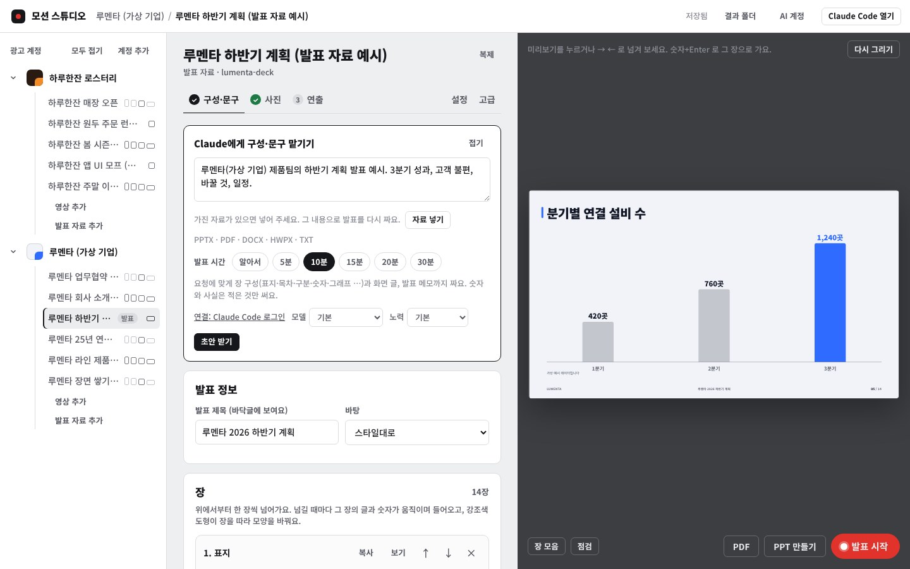

<div align="center">

# 모션 스튜디오

**문구와 사진만 넣으면 릴스·쇼츠·피드·유튜브용 모션 그래픽 광고가 한 번에 나와요.**<br>
광고 계정이 여럿이어도 계정마다 색·글꼴·로고·말투를 기억해 두고, 같은 영상을 네 가지 비율로 뽑아 줘요.



<sub>Windows 앱 · Claude가 문구와 구성을 같이 짜 줘요 · HTML + GSAP 엔진 · MP4 / PowerPoint / PDF 내보내기</sub>

</div>

---

## 이런 걸 해요

- **광고 영상**: 상황(신메뉴, 세일, 매장 오픈, 채용, 회사 소개 …)을 고르고 문구와 사진을 넣으면 움직이는 미리보기가 바로 나와요. 다 되면 **MP4 만들기** 한 번으로 업로드용 영상이 나와요.
- **네 가지 비율**: 9:16(릴스·쇼츠·틱톡), 4:5(인스타 피드), 1:1, 16:9(유튜브)를 한 번에 만들어요. 플랫폼 버튼에 가리는 자리(세이프존)도 미리 보여 줘요.
- **Claude와 같이**: "10월 한 달 체험 수업 1회 무료"처럼 알릴 내용만 적으면 브랜드 말투에 맞춰 문구 초안을 써 주고, 광고에 써도 되는 무료 사진을 찾아 어울리는지 점수까지 매겨 줘요.
- **스타일 180가지**: 잘 만든 프로덕트 영상에서 배운 색·글꼴·질감·움직임을 골라 입혀요.
- **발표 자료**: 넘길 때마다 한 장씩 모션으로 등장하는 16:9 발표 자료를 만들고, 고칠 수 있는 PowerPoint(애니메이션·모핑 전환 포함)나 PDF로도 내보내요.
- **음악·업로드**: 구글 Gemini로 영상 길이와 박자에 맞는 배경음악을 만들고, 유튜브 제목·설명·해시태그까지 정리해서 바로 올릴 수 있어요.

## 앱 둘러보기



왼쪽은 광고 계정과 영상 목록, 가운데는 문구·사진·음악·연출, 오른쪽은 움직이는 미리보기예요. 문구를 고치면 저장이 되고 미리보기도 바로 바뀌어요.

| 순서 | 하는 일 |
|---|---|
| **1 문구** | 칸마다 글자 수가 보여요. "Claude에게 문구 맡기기"로 초안을 받을 수 있어요 |
| **2 사진** | 내 사진을 끌어다 놓거나, 광고에 써도 되는 무료 사진(CC0·CC BY)을 찾아 넣어요. 출처 표시는 알아서 들어가요 |
| **3 음악** | Gemini로 만든 곡이나 가진 음원을 넣으면 박자를 재서 첫 박을 영상 시작에 맞춰요 |
| **4 연출** | 영상 길이, 스타일, 연출 프롬프트. 화면으로 안 되는 연출은 Claude Code에게 말로 맡겨요 |
| **5 올리기** | 유튜브·인스타 글과 해시태그, 플랫폼별 영상·커버를 묶은 업로드 안내 |

## 템플릿

상황마다 화면 구성이 완전히 다른 템플릿 31가지가 들어 있어요. 문구는 그대로 두고 템플릿만 바꿔 볼 수도 있어요.



<table>
<tr>
<td width="38%"></td>
<td>

**필름 템플릿**은 120BPM 박자 격자 위에서 한 컷으로 이어지는 영상이에요.
도형 하나가 버튼 → 플레이어 → 검색창 → 알림으로 모양을 바꾸며 이어지고, 60fps에 모션 블러까지 넣어서 뽑아요.

- `keynote` 런칭·채널 브랜딩 필름
- `uimorph` 앱 기능 소개 루프
- `showreel` 15초 쇼릴

상황 템플릿: 신메뉴, 세일, 매장 오픈, 시즌 인사, 수강생 모집, 행사, 채용, 공지, 여행, 성과, 회사 소개, 제품 소개, 연혁, 소식 발표<br>
결 템플릿: 타이포 쇼, 제품 화면 시연, 손그림 노트, 데이터 흐름, 레트로 터미널, 종이 콜라주, 사물 무대, 빛과 그라디언트, 브랜드 도형, 시네마틱

</td>
</tr>
</table>

## 스타일 180가지



연출 탭의 **스타일 고르기**에서 타이포, 제품 UI, 그라디언트·빛, 3D·사물, 손그림, 레트로·픽셀, 시네마틱 등으로 골라요. 고르면 글꼴과 질감, 큰 글이 등장하는 방식이 따라오고, 브랜드 색은 그대로 둘지 스타일 색으로 바꿀지 정할 수 있어요.

## 발표 자료

<table>
<tr>
<td width="55%"></td>
<td>

계정 아래 **발표 자료 추가**로 만들어요. 무슨 발표인지 적고 가진 자료(PPTX·PDF·DOCX·HWPX·TXT)를 넣으면, Claude가 그 내용으로 장 구성과 화면 글, 발표 메모까지 짜요.

- 표지·목차·구분·글머리·카드·숫자·막대 그래프·비교·단계·사진·인용·마무리
- 클리커로 넘겨요 (PageDown·방향키·스페이스, F5 전체 화면, B/W 검은·흰 화면, 숫자+Enter 장 이동)
- **PPT 만들기**: 글과 도형이 진짜 PowerPoint 개체라 바로 고칠 수 있고, 장마다 등장 애니메이션과 모핑 전환, 발표 메모, 글꼴까지 들어가요
- **PDF**: 장마다 마지막 화면을 3840×2160으로

</td>
</tr>
</table>



## 설치

**필요한 것**: Windows 10/11, 인터넷, Claude 계정(Claude Code 로그인 또는 Claude API 키)

1. 이 페이지 위의 초록색 **Code** 버튼 → **Download ZIP**으로 받아서 압축을 풀어요.
2. 풀린 폴더 안 `installer\Install_MotionStudio.cmd`를 더블클릭해요.
   "Windows의 PC 보호" 창이 뜨면 **추가 정보 → 실행**을 누르세요.
3. 질문이 나오면 Enter(기본값)로 넘어가면 돼요. 처음엔 10~20분쯤 걸려요.

설치가 끝나면 `문서\motion-studio`에 프로그램이 들어가고, 바탕화면에 아이콘이 두 개 생겨요.

- **모션 스튜디오**: 화면으로 쓰는 앱
- **모션 스튜디오 (Claude Code)**: 말로 시키는 Claude Code

설치 스크립트가 Claude Code, Python, ffmpeg, 렌더링용 크로미움을 알아서 깔아요. 구글 Gemini API 키는 음악을 자동으로 만들 때만 있으면 되고, 없어도 Gemini 앱에서 무료로 만든 곡을 끌어다 놓으면 돼요. 키는 이 PC의 사용자 폴더(`.motion-studio`)에만 저장돼요.

## 자동 업데이트

앱을 켤 때마다 이 저장소에 새 버전이 있는지 보고, 있으면 받아서 바꾼 뒤 **"새 버전으로 업데이트했어요"** 창으로 바뀐 점을 알려 줘요.

- 바꾸기 전에 백업하고, 새 버전에서 앱이 안 켜지면 저절로 이전 버전으로 돌아가요.
- 프로그램 파일만 바꿔요. 내 광고 계정·영상·결과물·API 키는 건드리지 않아요.
- PC에서 직접 고친 파일은, 새 버전에서 그 파일이 안 바뀌었으면 그대로 둬요.
- 인터넷이 없으면 그냥 지금 버전으로 켜져요. 끄려면 사용자 폴더 `.motion-studio\update` 안에 `off`라는 빈 파일을 만들면 돼요.

```
python tools/update.py --check      새 버전이 있는지만 보기
python tools/update.py --rollback   바로 전 버전으로 되돌리기
```

## Claude Code에 이렇게 시켜 보세요

바탕화면의 **모션 스튜디오 (Claude Code)**로 열고 말로 시키면 돼요.

```
/new-brand 민트 필라테스. 로고는 바탕화면 mint-logo.png, 말투는 친근한 해요체
/new-ad 민트 필라테스 10월 체험 수업 1회 무료, 릴스랑 피드용으로
/ad-review mint-oct-trial
/render-mp4 mint-oct-trial all
/music mint-oct-trial 밝고 경쾌한 분위기
/new-deck 3분기 성과 보고, 자료는 바탕화면 실적보고.pptx
```

슬래시 없이 "하루한잔 겨울 신메뉴 광고 영상 만들어 줘"처럼 말해도 돼요.

<details>
<summary><b>명령어로 직접 쓰기</b></summary>

`python`이 안 되면 `py -3`으로 바꿔 실행하세요.

```
python tools/list.py                                         # 계정·영상 목록과 상태
python tools/presets.py                                      # 상황 프리셋 목록
python tools/new_video.py mint-oct-sale --brand mint --preset sale
python tools/build.py <영상>                                  # 미리보기 HTML (더블클릭하면 브라우저에서 재생)
python tools/render.py <영상> all sheet                       # 검수용 장면 모음
python tools/render.py <영상> tall video                      # 화면 렌더
python tools/finalize.py <영상> tall --music 곡.mp3            # 업로드용 MP4 (음량 -14 LUFS)
python tools/deck.py pdf <발표>                                # 발표 자료 PDF
python tools/deck_pptx.py <발표>                               # 고칠 수 있는 PowerPoint
python tools/upload.py kit <영상>                              # 업로드 안내 묶음
python tools/make_installer.py                               # 설치 파일 만들기
```

전체 명령과 작업 규칙은 [CLAUDE.md](CLAUDE.md), 템플릿 항목은 [docs/TEMPLATES.md](docs/TEMPLATES.md), 엔진 API는 [docs/ENGINE.md](docs/ENGINE.md)에 있어요.

</details>

<details>
<summary><b>폴더 구성</b></summary>

| 폴더 | 내용 |
|---|---|
| `app/` · `tools/app.py` | 화면으로 쓰는 앱 |
| `engine/` | 공용 모션 엔진 (타임라인, 효과, 전환, 세이프존, 스프링·박자·카메라 도구) |
| `templates/` | 템플릿 31가지 |
| `presets/` | 상황 프리셋 (템플릿·길이·필요한 사진·연출 프롬프트·음악 분위기) |
| `styles/` | 스타일 180가지 (`style.json`, 스타일 카드 `style.md`, 썸네일) |
| `tools/` | 빌드·렌더·사진·음악·업로드·업데이트 명령 |
| `fonts/` · `vendor/` | 한글 글꼴, GSAP |
| `brands/` · `videos/` | 내 광고 계정과 영상 (저장소에는 새 계정의 틀만 있어요) |
| `out/` | 결과물 (미리보기 HTML, 장면 모음, MP4, PDF, PPT) |

</details>

## 알아 둘 점

- 사진은 직접 찍은 것, CC0·퍼블릭 도메인, CC BY(화면에 출처 표시)만 써요. 광고에 못 쓰는 라이선스(BY-SA, NC, ND)는 걸러요.
- "최고·1위·100%" 같은 표현, 지어낸 후기·평점은 넣지 않게 점검해요.
- Gemini 음악처럼 돈이 드는 생성은 누를 때마다 비용을 먼저 보여 주고 확인을 받아요.
- 필름 템플릿은 60fps에 모션 블러를 넣어서, 20초 영상 하나 렌더에 10분 안팎 걸려요.
- PPT에 글꼴을 넣는 기능은 PowerPoint가 깔린 PC에서만 돼요.

<sub>이 페이지의 예시 브랜드 "하루한잔"과 "루멘타"는 템플릿을 보여 주려고 만든 가상 브랜드예요. 예시 사진은 위키미디어 커먼즈의 CC0·퍼블릭 도메인 사진이에요.
글꼴: Noto Sans/Serif KR, 나눔손글씨, 고운바탕, 갈무리, Cinzel, Archivo, Geist 등 (SIL Open Font License, `fonts/` 안 라이선스 파일 참고) · 애니메이션: GSAP 3.12.5</sub>
